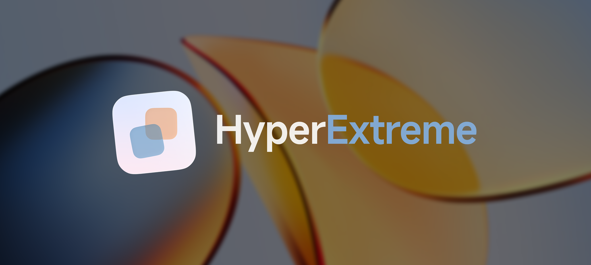

> ### 致谢 / Credits
>
> 本项目是 **[HyperExtreme](https://github.com/22Frederic/HyperExtreme)** 的 Fork，原作者 **[22Frederic](https://github.com/22Frederic)**。
>
> 感谢原作者的开源与持续维护。本仓库的所有改动、发行包与问题由维护者负责，**与原作者无关**；
> 使用本仓库版本遇到问题时，请反馈到本仓库（Issues），不要去打扰原作者。
>
> 上游与本 Fork 均采用 **AGPL-3.0** 许可，本 Fork 的修改同样按 AGPL-3.0 公开。
>
> ---
>
> ### 本 Fork 说明
>
> 目标：修好 **Alive 壁纸在锁屏/AOD 不显示**，并让它能与 **HyperMusicCover** 共存；同时提供一个能与官方版**并排安装**的发行包。
>
> **分支**
>
> | 分支 | 用途 | 包名 |
> |---|---|---|
> | `main` | 本说明 + 上游代码 | `com.frederic22.hyperextreme`（同官方） |
> | `fix/upstream-alive` | 可直接安装的改版（含改包名/签名脚本） | `com.frederic22.hyperextreme.alive`（可与官方共存） |
> | `pr/alive` | 只含功能修复、未改包名，用于向上游提 PR | 同官方 |
>
> **主要修复（`pr/alive` 与 `fix/upstream-alive` 共有）**
>
> 1. **壁纸基底**：应用 Alive 时用卡片照片**单次 `setBitmap(SYSTEM|LOCK)`** 把锁屏+桌面写成同一张静态图，
>    再 `killall com.miui.miwallpaper` 重建壁纸层。替代上游 `clear(both)` 回默认的做法 ——
>    实测 `clear(both)` 之后 `getWallpaperId` 仍是 397/396（锁屏保留独立壁纸），Alive 在锁屏不可见。
> 2. **挂载可靠性**：拿不到壁纸 leash 时 250ms×12 重试；失败判据由 `mounts` 改为 `kept`
>    （否则全挂失败也会当成功，渲染器空转、屏幕全黑）；遇到景深壁纸（pictorial）继续等 `ImageWallpaper`。
> 3. **与 HyperMusicCover 共存**：常驻 `MusicWatch` 探测「音乐屏」视图，出现时 Alive 淡出、停画帧、
>    并把 `keyguard_foreground_layer` 让给歌词（同时摘掉系统人像）；退出后自动恢复。AOD 期间同样按此让路。
>
> **安装（`fix/upstream-alive` 分支的发行包）**
>
> - 包名 `com.frederic22.hyperextreme.alive`，可与官方版、其它改版**并排安装**
> - 签名 `CN=HyperExtreme Alive`（自建 key，非官方签名）
> - LSPosed 里是独立模块：**不要与原版 HyperExtreme 同时启用**（会双份 hook）
> - 已知问题：从桌面灭屏进 AOD 时可能出现两个重叠日期（上游 v1.22.81 同样存在，待定位）
>
> ---

  

  
  
  
  
  

## 介绍

HyperExtreme是一款LSPosed美化模块，支持空间壁纸、光栅壁纸、Alive壁纸等功能，部分功能支持免Root运行。

## 兼容性

对于空间壁纸、光栅壁纸：LSPosed模式只在澎湃OS4上测试，也只会对澎湃OS4适配，**不受理任何澎湃OS4以外系统的使用问题**；系统壁纸服务（免Root）模式理论支持到安卓13，但对安卓17之外的安卓版本未测试。

对于Alive壁纸与其他功能：都需要Root与LSPosed，只会对澎湃OS4适配，**不受理任何澎湃OS4以外系统的使用问题**。

## 使用说明

对于需要LSPosed的功能，请先提前勾选并重启所有推荐作用域（初次安装及模块更新时），再使用对应功能。

本模块可能对修改较多的HyperOS ROM或修改过的推荐作用域应用不生效甚至导致其他问题。

本模块可能与其他修改相同作用域的LSPosed模块产生冲突，在使用模块出现问题时，请先排查模块冲突。

## 开源代码许可

本项目采用AGPL-3.0许可证，有关开源代码许可请在模块的关于页查看。
